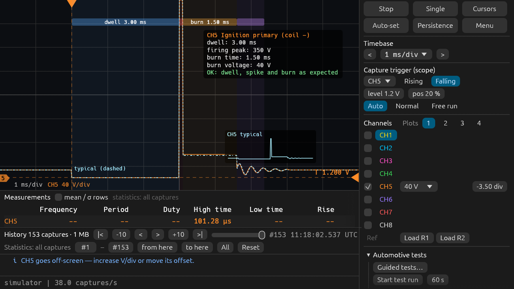
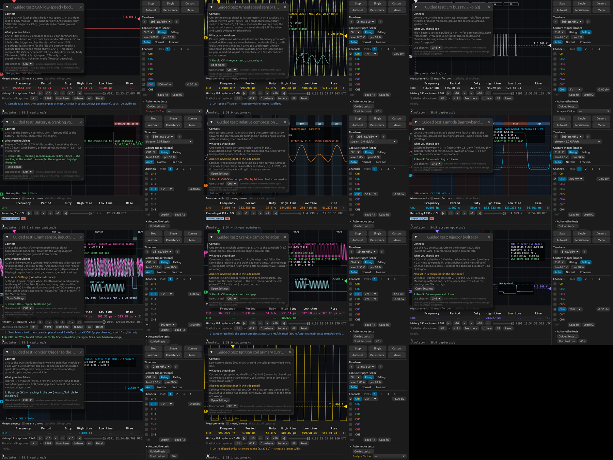

# LR Scope 1008C

**Free, fast automotive oscilloscope software for the Hantek 1008C — by Light Racing.**

The Hantek 1008C is an affordable 8-channel USB scope that ships with Windows-only software. LR Scope 1008C is a
fast, lag-free native replacement (Rust, egui/wgpu, libusb) built for car diagnostics: guided tests that set up the scope for you and
recognise the parts of a waveform, serial-bus decoding, long gap-free recordings — on Linux (tested) and Windows
(experimental build).

> Hantek and 1008C are trademarks of Qingdao Hantek Electronic Co., Ltd. This project is independent and not
> affiliated with, endorsed by, or supported by Hantek.



## Built for speed

Speed is the first design rule: a scope that lags is useless at the car.

- **60 fps, no lag**: drawing a frame takes about 0.1 ms (measured on the real scope with live captures); the display
  follows every control instantly, also with 8 channels, math, FFT, persistence and analysis on.
- **The acquisition never waits**: USB capture runs in its own thread and hands each capture to the display through a
  lock-free triple buffer; recording to disk has its own writer thread with a RAM buffer, so a slow disk or a busy
  screen never costs a capture.
- **As fast as the hardware allows**: ~39 captures per second at fast timebases (the USB limit of the 1008C), every
  USB command timed and trimmed against the original driver.
- **Light analysis**: waveform analysis runs once per new capture (6–38 µs each), not per frame.
- **Adaptive quality**: on a slow PC, optional extras (persistence, math, references …) pause automatically to keep
  at least 20 fps, and come back when there is room.

## Features

- **Scope**: 8 channels, run / stop / single, auto-set, hardware trigger (rising / falling, level, position) with
  trigger-jitter correction, software match filter (pulse width, runt, dropout, window, zone), up to 4 plots,
  zoom (drag / scroll, touchpad friendly), cursors, measurements with statistics, persistence, math channels
  (A±B, A×B, scale, low-pass, AC part, |A|, rpm, FFT), probes and units (×10 / ×20 attenuator, current clamps).
- **Guided tests** (one click sets channels, ranges, timebase, trigger and analysis, with what to connect and what to
  expect): crank and cam sensors, crank/cam correlation with TDC markers, injector, ignition trigger, coil primary
  voltage and current,
  lambda, battery and cranking, relative compression, wheel-speed sensors, CAN and LIN.
- **Waveform analysis**: the phases of the signal are found and highlighted (injector open / flyback / pintle,
  ignition dwell / spike / burn / ringing, missing teeth, rich / lean, compression humps …) with readings and an
  OK / CHECK verdict; a typical healthy waveform for comparison; calm "waiting for a signal" when nothing is connected.
- **Test runs**: analyse every capture for a set time (e.g. an injector or coil test) and get a report — failed
  injections, misfires, irregular teeth, min / mean / max of every reading, share of time actually checked.
- **Decoding**: LIN, K-line, CAN-H / CAN-L (standard and extended frames, CRC check), CAN log export as Vector ASC;
  experimental 1-channel mode for 500 kbit/s CAN.
- **Recording**: streams of any length straight to disk (crash-tolerant `.h8r`), history of every capture, browse and
  search back; export as CSV, WAV, ASAM MDF4 or sigrok; screenshots with the settings in the file name and metadata.
- **References**: save a known-good signal of any channel (library of CSV files), load it again any time and draw it
  under any channel.
- **Simulator**: `--sim` runs everything without a scope (realistic engine signals for every guided test).



## What the hardware can do

The 1008C samples 2.4 MS/s in total: **300 kS/s per channel with all 8 channels**, 4000 samples per capture, about
30–40 captures per second over USB (so fast timebases see a fraction of real time). Streaming (roll mode) is gap-free
at up to 2 kS/s. That is plenty for sensors, actuators, ignition and injection, LIN and 100–125 kbit/s CAN; 500 kbit/s
CAN only in the experimental 1-channel mode and as a sample, never as a complete log. See
[re/PROTOCOL.md](re/PROTOCOL.md) for the measured details.

## Install

### Linux (tested on Ubuntu)

```sh
# Rust toolchain (if needed): https://rustup.rs
sudo cp udev/60-hantek1008.rules /etc/udev/rules.d/ && sudo udevadm control -R   # USB access without root, then re-plug the scope
scripts/install-linux.sh    # builds and installs ~/.local/bin/lrscope and an "LR Scope 1008C" app launcher
```

Run `lrscope` (or the launcher), `lrscope --sim` without a scope. The file dialogs use `zenity` (GNOME) or `kdialog`
(KDE).

### Windows (experimental, cross-built from Linux)

`scripts/build-windows.sh` (needs `sudo apt install mingw-w64`) makes `dist/LRScope1008C-windows-<version>.zip`. On
Windows, switch the scope's USB driver to **WinUSB** once with [Zadig](https://zadig.akeo.ie) (device 0783:5725);
the original Hantek software then no longer sees the scope until the driver is switched back.

## Use

- **F1** lists all keyboard shortcuts; every control explains itself on long press / hover; advice appears in the info
  line under the plot. More room for the waveform: **F4** collapses the side panel, **F3** hides the measurement
  table.
- **Menu → Automotive tests / Protocol decoding** or the side panel's *Guided tests…* start a guided test.
- Settings: `~/.config/hantek1008c` (Windows `%APPDATA%\hantek1008c`); recordings, exports, references and
  screenshots: `~/Documents/hantek1008c/recordings`.
- Command line: `lrscope check` (hardware self-test with CH1 on the scope's 1 kHz generator), `lrscope bench`
  (USB speed), `lrscope calibrate` (gain against a multimeter), `lrscope soak` (simulator endurance run).

## Safety

Measurement results may be inaccurate; this is not a certified instrument. On a vehicle: respect the scope's input
limits (use the ×20 attenuator for ignition and injector signals, never connect ignition secondary directly), keep
clear of moving parts, hot surfaces and fuel, secure cables, and never operate it while driving. Use at your own risk
— see the license: no warranty, no liability for damage to vehicles, control units, computers or the scope.

## Development

`cargo test --release` runs the test suite (signal analysis, decoders, recording format, and the real app on the
simulator without a window); `scripts/regress.sh --long` adds long simulator runs and a soak test; tests marked
`hw_` (`cargo test --release -- --ignored hw_`) run against a connected scope. Architecture and data flow:
[ARCHITECTURE.md](ARCHITECTURE.md); USB protocol notes: [re/PROTOCOL.md](re/PROTOCOL.md).

## Credits and license

The USB protocol started from [hantek1008py](https://github.com/mfg92/hantek1008py) (Apache-2.0), see
[NOTICE](NOTICE). LR Scope 1008C is licensed under the [Apache License 2.0](LICENSE); third-party licenses, including
libusb (LGPL-2.1, linked statically), are listed in [THIRD-PARTY-LICENSES.md](THIRD-PARTY-LICENSES.md).

© Light Racing
